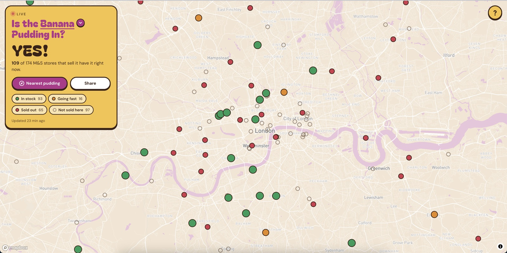
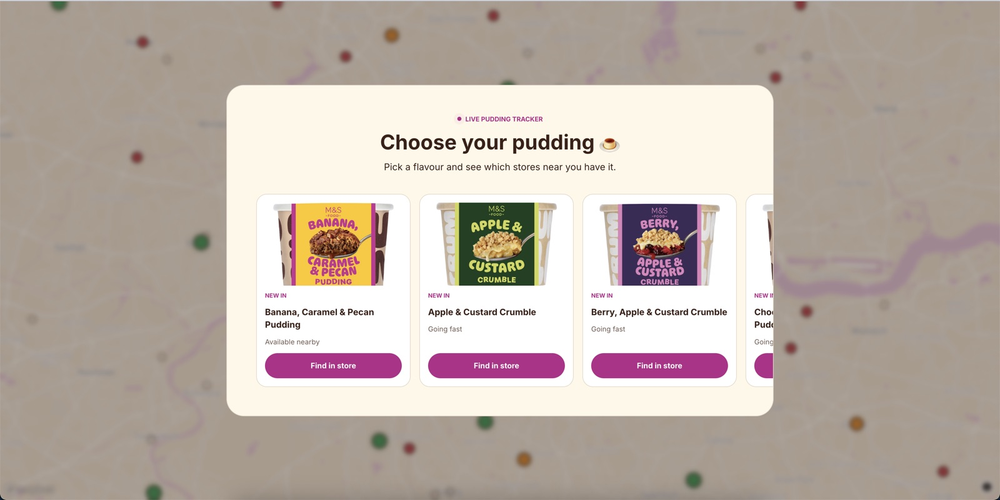
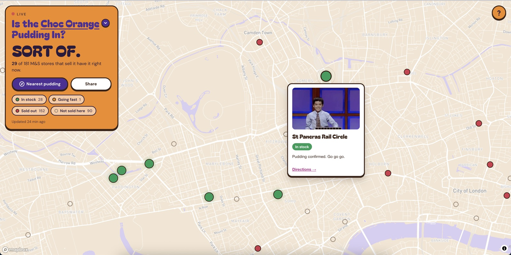
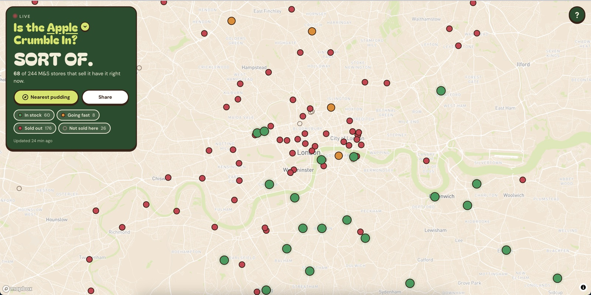

# Out of Pud 🍮

**Is the M&S pudding in? A live map that tells you which London stores still have it.**

👉 **[outofpud.com](https://outofpud.com)**



## The story

M&S launched a range of pudding pots and they went viral. We wanted the banana one. Every store we tried was sold out.

So we built a map that checks every M&S near London every 30 minutes. We found one. Now anyone can.

## What it does

- **One question, one answer.** Pick a flavour and the headline says *YES!*, *SORT OF.* or *RARELY.*
- **Every store, colour-coded.** Green is in stock, orange is going fast, red is sold out.
- **Nearest pudding.** One tap finds the closest store that has it, with directions.
- **Each flavour has its own look.** The whole site recolours to match the pack.
- **Shareable.** The link preview image redraws itself with the latest numbers after every check.

| Choose your pudding | Tap a store |
|---|---|
|  |  |

| Switch flavour, switch skin | About the project |
|---|---|
|  |  |

## How it works

- **Live stock, ~270 stores, every 30 minutes.** A headless browser opens the product page and asks M&S's own "check stock in store" feature about every store at once, just as a shopper would. One check takes about 35 seconds.
- **No servers, no running costs.** GitHub Actions does the checking and GitHub Pages hosts the site. A free scheduler starts each run.
- **It remembers.** 30 days of readings are kept, one letter per store per half hour, small enough to ship with the page.
- **Gentle by design.** One request batch per flavour per half hour, no clicking around, no scraping loops.
- **Add a flavour in one line.** A new product in `data/products.json` gets polled, mapped and skinned automatically.

Built in 24 hours with Python, Playwright and Mapbox.

## Made by

Haiden and Khumbira. Questions or puddings: furious@outofpud.com

*An unofficial fan project. Not affiliated with M&S.*

---

<details>
<summary>Running it locally</summary>

```sh
uv run python -m scripts.poll          # live poll (~35s)
uv run ruff check . && uv run pytest   # checks
```

Developer notes (tokens, scheduler, history, troubleshooting) live in [CLAUDE.md](CLAUDE.md).
</details>
